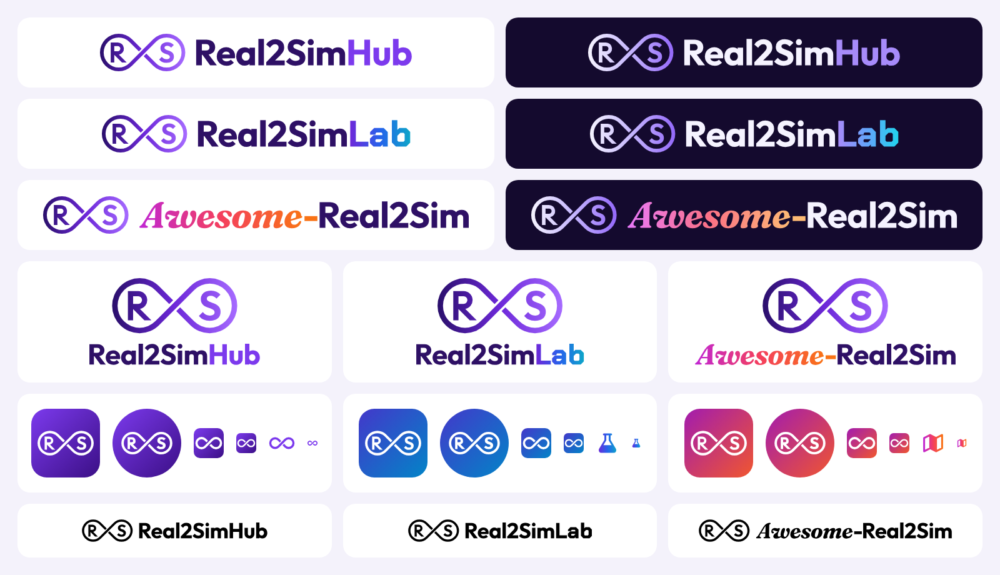

# Real2SimHub logo family



**The mark.** One ribbon runs from Real (**R**) to Sim (**S**) and back, as an infinity sign. The two
loops are circles joined by 45-degree lines; the leg of the R and the ends of the S are cut at the same
45 degrees. The colour deepens on the Real side and brightens on the Sim side.

**The names.** Every project shares the mark and the word "Real2Sim", always in one font and one colour.
Its own word tells it apart:

| Project | Own word | Font | Colour |
|---|---|---|---|
| Real2SimHub, the root | Hub | Outfit, as "Real2Sim" | one plain violet |
| Real2SimLab | Lab | Chakra Petch, its corners cut at 45 degrees like the mark | violet to blue to cyan |
| Awesome-Real2Sim | Awesome- | Fraunces italic, a literary serif | magenta to rose to orange |

**The symbols.** Beside a project's name in small type, a symbol of its own stands for it: the loop of the
mark for Hub, a flask for Lab, a map for Awesome. They differ in shape, not only in colour.

A new project keeps the mark and "Real2Sim", and gets a font, a gradient and a symbol of its own (entries
in `PROJECTS` and `SYMBOLS` of `scripts/make_brand.py`).

## Files

`NAME` is `real2simhub`, `real2simlab` or `awesome-real2sim`.

| Use | File |
|---|---|
| Websites, slides, README headers | `svg/NAME-logo.svg`, `-dark.svg` on dark backgrounds |
| Narrower than about 300 px | `svg/NAME-logo-small.svg`, `-small-dark.svg` |
| Posters, covers | `svg/NAME-logo-stacked.svg`, `-dark.svg` |
| The mark alone | `svg/real2sim-mark.svg`, `-dark.svg`; under 90 px wide `-small.svg`, `-small-dark.svg` |
| The loop without letters, under 50 px wide | `svg/real2sim-loop.svg`, `-dark.svg` |
| One colour (print, stamps, embroidery) | `-black.svg`, `-white.svg` of the logo, stacked logo, mark and loop |
| Beside a project's name at about 20 px (tabs of the site, rows in a README) | `svg/NAME-symbol.svg`, `-dark.svg` |
| Browser tab | `svg/NAME-favicon.svg` (its colours follow the browser's theme), `NAME.ico` |
| App icon | `svg/NAME-icon.svg`; under 64 px `svg/NAME-icon-small.svg` |
| GitHub or social-media avatar | `png/NAME-avatar-1024.png` (square; the site rounds it) |
| The organisation's GitHub avatar | `png/real2sim-avatar-1024.png`: the mark in its own colours on white, as in the READMEs and the paper |
| Link preview, repository social image | `png/NAME-social.png` (1280 x 640) |
| LaTeX | `pdf/NAME-logo.pdf`, `pdf/real2sim-mark.pdf` and their dark and one-colour versions |

Every SVG and PDF is outlines only and needs no font. Transparent PNG versions are in `png/`.

In a GitHub README:

```html
<picture>
  <source media="(prefers-color-scheme: dark)" srcset="real2simlab-logo-dark.svg">
  
</picture>
```

## Colours

| | Light background | Dark background |
|---|---|---|
| Mark, left to right | `#2A0F6B`, `#6D28D9`, `#A66BFF` | `#F5F3FF`, `#C4B5FD`, `#9469FA` |
| "Real2Sim" | `#2E1065` | `#F5F3FF` |
| "Hub" | `#7C3AED` | `#A78BFA` |
| "Lab", left to right | `#6D28D9`, `#2563EB`, `#0EA5C9` | `#A78BFA`, `#60A5FA`, `#22D3EE` |
| "Awesome", left to right (hyphen: the last) | `#C026D3`, `#F43F5E`, `#F97316` | `#E879F9`, `#FB7185`, `#FDBA74` |
| Background | `#FFFFFF` | `#140A2E` |

Icon tiles, diagonal: Hub `#7C3AED` to `#3B0F86`, Lab `#4338CA` to `#0284C7`, Awesome `#A21CAF` to `#F0562F`.

## Rules

- Keep free space around the logo of at least the height of the letter "e".
- Do not stretch, rotate, mirror, outline or recolour it.
- "Real2Sim" never changes its font or colour from project to project.
- On a photo or a busy background, use the icon tile or the one-colour version.

## Redraw

`python3 scripts/make_brand.py --fonts DIR` draws every file again. DIR holds three fonts from
[google/fonts](https://github.com/google/fonts), all under the SIL Open Font License 1.1:
[Outfit](https://github.com/Outfitio/Outfit-Fonts) ("Real2Sim", "Hub" and the S of the mark),
[Chakra Petch](https://github.com/m4rc1e/Chakra-Petch) ("Lab", strokes slightly thickened) and
[Fraunces](https://github.com/undercasetype/Fraunces) ("Awesome").
